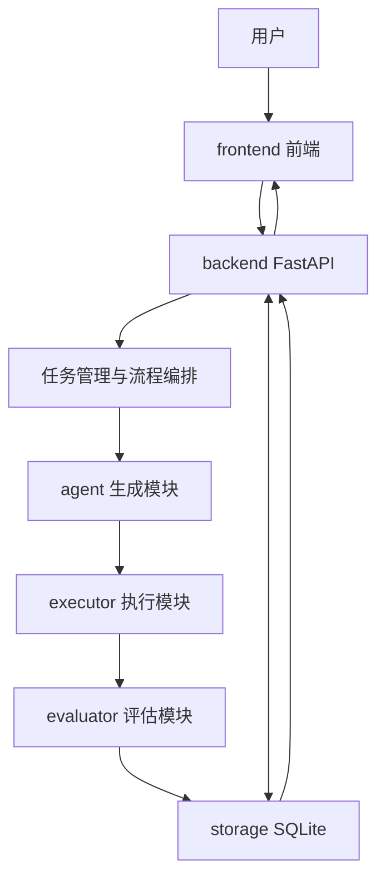

# 系统架构设计文档

## 1. 设计目标
第一阶段在没有真实模型 API 和 GPU 的情况下，完成任务管理、统一模块接口、数据存储、结果展示和 `vector_add` 模拟闭环。模拟结果必须明确标注，不得称为真实 GPU 测试。

## 2. 总体架构图



## 3. 模块职责与后续变化

| 模块 | 第一阶段 | API/GPU 到位后 |
|---|---|---|
| `frontend/` | 提交任务、查看状态/代码/结果 | 基本保留，按需增加设备信息 |
| `backend/` | FastAPI、任务管理、状态流转、流程编排 | 主体保留，补充真实执行参数和异常处理 |
| `agent/` | 返回预设代码的模拟生成器 | 替换内部实现为真实模型 API 调用 |
| `executor/` | 返回受控模拟结果，不执行任意生成代码 | 替换内部实现为隔离环境中的真实 GPU 执行 |
| `evaluator/correctness.py` | 参考结果与实际结果比较 | 保留比较框架，适配真实张量、精度和容差 |
| `evaluator/benchmark.py` | 记录标记为模拟的耗时 | 替换计时方式为真实设备测量 |
| `storage/` | SQLite 保存任务和结果 | 通常保留，按需扩展字段 |
| `tests/` | 单元、API、模拟闭环测试 | 保留基础测试，增加真实环境集成测试 |

## 4. 模块边界
- 后端负责组织流程；生成算法、执行算法不写进 API 路由。
- `agent` 不直接操作数据库或前端。
- `executor` 只负责执行并返回结构化结果。
- `evaluator` 只负责评估。
- `storage` 只负责持久化和查询。
- 前端只通过 HTTP API 与后端通信。

## 5. 建议目录

```text
kernel-agent-platform/
├── backend/       # API、任务管理、流程编排
├── agent/         # 生成器
├── executor/      # 执行器
├── evaluator/     # 正确性、性能评估
├── storage/       # SQLite
├── frontend/      # 页面
├── tests/         # 自动化测试
└── docs/          # 项目文档
```

这是建议结构，合并前先对照现有仓库，勿覆盖或删除已有文件。

## 6. 统一接口原则
- `generate(task) -> GenerationResult`
- `run(task, generation_result, test_case) -> ExecutionResult`
- `evaluate(expected, actual, tolerance) -> EvaluationResult`
- `measure(...) -> BenchmarkResult`

模拟实现与真实实现遵守同样的数据契约。资源到位后优先替换 `agent`、`executor` 的内部实现和性能测量方式，避免推翻任务管理和前端。

目标国产 GPU 型号、驱动、框架、Triton 版本和模型 API 尚未确定，真实执行适配范围需要资源确定后验证。
