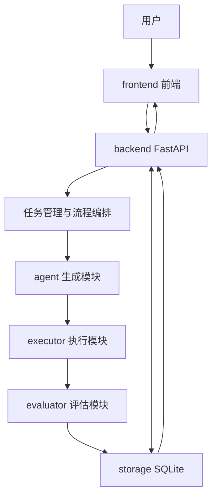

# 系统架构设计文档

## 1. 设计目标
第一阶段在没有真实模型 API 和 GPU 的情况下，完成任务管理、统一模块接口、数据存储、结果展示和 `vector_add` 模拟闭环。模拟结果必须明确标注，不得称为真实 GPU 测试。

## 2. 总体架构图



## 3. 模块职责与后续变化

| 模块 | 第一阶段 | API/GPU 到位后 |
|---|---|---|
| `frontend/` | 提交任务、查看状态/代码/结果 | 基本保留，按需增加设备信息 |
| `backend/` | FastAPI、任务管理、状态流转、流程编排 | 主体保留，补充真实执行参数和异常处理 |
| `agent/` | 返回预设代码的模拟生成器 | 替换内部实现为真实模型 API 调用 |
| `executor/` | 返回受控模拟结果，不执行任意生成代码 | 替换内部实现为隔离环境中的真实 GPU 执行 |
| `evaluator/correctness.py` | 参考结果与实际结果比较 | 保留比较框架，适配真实张量、精度和容差 |
| `evaluator/benchmark.py` | 记录标记为模拟的耗时 | 替换计时方式为真实设备测量 |
| `storage/` | SQLite 保存任务和结果 | 通常保留，按需扩展字段 |
| `tests/` | 单元、API、模拟闭环测试 | 保留基础测试，增加真实环境集成测试 |

## 4. 模块边界
- 后端负责组织流程；生成算法、执行算法不写进 API 路由。
- `agent` 不直接操作数据库或前端。
- `executor` 只负责执行并返回结构化结果。
- `evaluator` 只负责评估。
- `storage` 只负责持久化和查询。
- 前端只通过 HTTP API 与后端通信。

## 5. 建议目录

```text
kernel-agent-platform/
├── backend/       # API、任务管理、流程编排
├── agent/         # 生成器
├── executor/      # 执行器
├── evaluator/     # 正确性、性能评估
├── storage/       # SQLite
├── frontend/      # 页面
├── tests/         # 自动化测试
└── docs/          # 项目文档
```

这是建议结构，合并前先对照现有仓库，勿覆盖或删除已有文件。

## 6. 统一接口原则
- `generate(task) -> GenerationResult`
- `run(task, generation_result, test_case) -> ExecutionResult`
- `evaluate(expected, actual, tolerance) -> EvaluationResult`
- `measure(...) -> BenchmarkResult`

模拟实现与真实实现遵守同样的数据契约。资源到位后优先替换 `agent`、`executor` 的内部实现和性能测量方式，避免推翻任务管理和前端。

目标国产 GPU 型号、驱动、框架、Triton 版本和模型 API 尚未确定，真实执行适配范围需要资源确定后验证。


## 共享数据模型层（Contracts Layer）

### 1. 设计目的

为了保证 backend、agent、executor、evaluator 和 storage 等模块之间的数据格式一致，项目增加独立的共享数据模型层 `contracts/`。

该层负责定义系统内部统一使用的数据结构，包括：

- 任务数据；
- 测试用例；
- 通用错误信息；
- 代码生成结果；
- 算子执行结果；
- 正确性评估结果；
- 性能评估结果；
- 统一任务结果。

共享模型使用 Pydantic v2 实现，提供数据校验和序列化能力。

### 2. 在系统架构中的位置

```text
                  frontend
                      |
                      | HTTP / JSON
                      v
                   backend
                      |
                      v
              contracts（共享模型）
                /    |    \
               /     |     \
              v      v      v
            agent executor evaluator
                              |
                              v
                            storage
```

说明：

1. frontend 通过 HTTP API 与 backend 通信。
2. backend 负责接收请求、创建任务和协调任务流程。
3. agent、executor、evaluator 根据共享模型处理和返回数据。
4. storage 负责将任务和结果持久化。
5. contracts 为各模块提供统一的数据结构。

上图表示数据模型在模块之间的使用关系，不代表所有模块必须直接相互调用。

### 3. 目录结构

```text
kernel-agent-platform/
├── contracts/
│   ├── __init__.py
│   ├── common.py
│   ├── task.py
│   └── results.py
├── backend/
├── agent/
├── executor/
├── evaluator/
├── storage/
├── frontend/
├── tests/
└── docs/
```

### 4. 模块依赖原则

为了降低模块之间的耦合程度，采用以下约定：

1. `contracts/` 只负责数据模型定义，不调用业务模块。
2. backend、agent、executor、evaluator 和 storage 可以导入 `contracts/` 中的模型。
3. 不允许在不同业务模块中重复定义同一份共享数据模型。
4. `contracts/` 不依赖 backend、agent、executor、evaluator 或 storage。
5. 模块之间通过约定好的函数参数和返回值传递数据。

这样，当某个模块内部实现发生变化时，只要共享数据契约不变，其他模块通常不需要跟着修改。

### 5. 数据层与业务逻辑分离

项目将数据结构定义和业务功能实现分开：

| 层次 | 主要职责 |
|---|---|
| contracts | 定义统一数据模型 |
| backend | 任务管理和流程编排 |
| agent | 算子代码生成 |
| executor | 算子执行 |
| evaluator | 正确性与性能评估 |
| storage | 数据持久化 |
| frontend | 用户交互和结果展示 |

共享数据模型不会替代任何业务模块，而是为它们提供统一的数据接口。

### 6. 后续扩展

未来接入真实模型 API、真实 GPU 执行环境以及更多算子类型时，应尽量保持现有数据契约稳定。

如果新增功能需要新的输入或输出字段，应先检查现有模型能否满足需求，再决定是否扩展共享模型。

不应为了增加一种执行环境，就在所有业务模块中重复定义一套新的任务数据结构。
