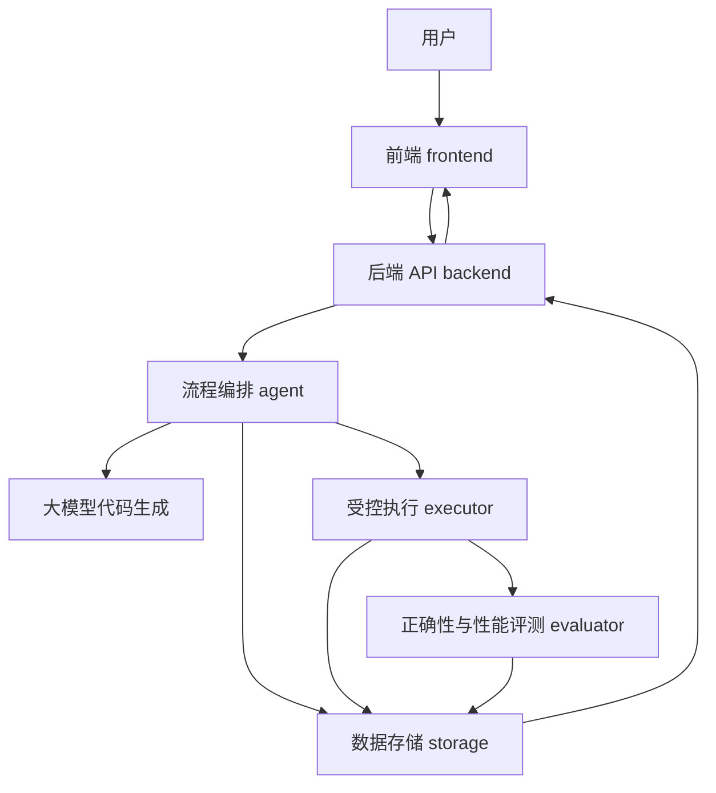

# 系统架构设计

> 项目：基于大语言模型的 GPU 算子自动生成与测试平台  
> 文档状态：初始设计，需随实际实现更新  
> 最后更新：YYYY-MM-DD

## 1. 项目目标

用户提交算子任务后，系统调用大语言模型生成候选 Kernel，在受控环境中执行编译、正确性测试和性能评测，并保存代码、日志和结果。

中级实训首先完成一个最小可行闭环，不要求一开始实现多 Agent、复杂搜索或跨硬件适配。

## 2. 初始架构

## 3. 模块职责

| 模块 | 职责 | 初期交付 |
|---|---|---|
| `frontend/` | 创建任务、查看状态和结果 | 简单任务表单与结果页 |
| `backend/` | HTTP API、参数校验、状态查询 | FastAPI 服务 |
| `agent/` | 任务解析、提示词构造、模型调用、流程编排 | 固定工作流 |
| `executor/` | 在隔离环境执行生成代码 | 超时、退出码、日志 |
| `evaluator/` | 正确性测试与性能测量 | 一个算子的测试脚本 |
| `storage/` | 保存任务、代码版本、实验记录 | SQLite 或明确约定的存储实现 |
| `configs/` | 任务和运行参数 | 示例任务配置 |
| `tests/` | 单元、集成和端到端测试 | 基础自动化测试 |
| `docs/` | 架构、接口、开发和实验文档 | 持续维护 |

## 4. 核心工作流

1. 接收任务并校验算子类型、输入形状、数据类型和后端。
2. 创建唯一任务 ID，并记录任务配置。
3. 调用模型生成候选代码。
4. 保存生成代码及必要的模型调用元数据。
5. 在受控环境中编译并运行测试。
6. 只有正确性测试通过后，才执行正式性能测量。
7. 保存状态、日志、环境信息和测量结果。
8. 向前端返回任务状态与结果。

## 5. 任务状态建议

- `pending`：等待执行
- `generating`：正在生成代码
- `compiling`：正在编译
- `testing`：正在进行正确性测试
- `benchmarking`：正在测量性能
- `completed`：流程完成
- `failed`：发生错误
- `timeout`：执行超时

状态应由后端根据真实执行过程更新，不能由模型自行声称成功。

## 6. 关键设计原则

- **模块解耦：** 通过明确的输入输出接口通信。
- **结果可追溯：** 每条实验结果关联任务 ID、代码版本和环境信息。
- **先正确后测速：** 未通过正确性测试的实现不进入正式性能比较。
- **安全执行：** 不在 Web 后端主进程中直接执行不可信的生成代码；设置隔离、超时和资源限制。
- **先小后大：** 先支持一个经过验证的算子和一个后端，再逐步扩展。
- **如实记录：** 区分已实现、计划中和实验性功能。

## 7. 待团队确认

- [ ] 可用 GPU/加速器与驱动环境
- [ ] 算子语言和后端（例如 Triton，需环境验证）
- [ ] 大模型服务与调用额度
- [ ] 前端技术栈
- [ ] 执行隔离方案
- [ ] 数据库与实验数据保存策略

## 8. 更新记录

| 日期 | 修改人 | 修改内容 |
|---|---|---|
| YYYY-MM-DD | 姓名/账号 | 创建初始架构文档 |
