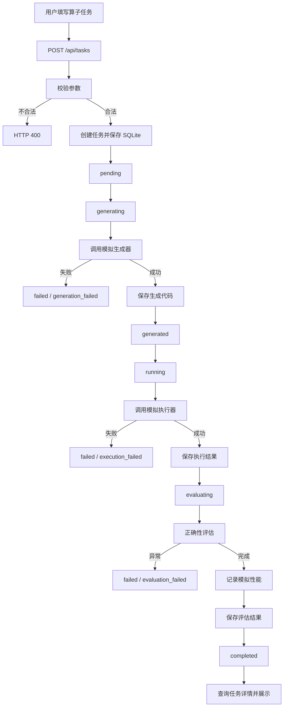
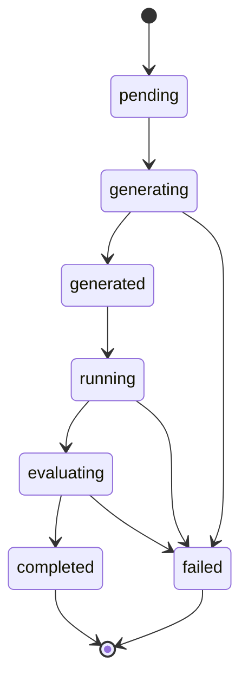

# 系统流程与状态流转

## 1. 端到端流程图

## 2. 统一任务状态

| 状态 | 含义 |
|---|---|
| `pending` | 已创建，等待处理 |
| `generating` | 正在生成代码 |
| `generated` | 代码生成成功 |
| `running` | 正在执行 |
| `evaluating` | 正在评估 |
| `completed` | 流程完成 |
| `failed` | 流程失败 |

## 3. 状态图

## 4. 失败阶段
任务状态统一写 `failed`，具体失败阶段放在 `failure_stage`：
- `generation_failed`
- `execution_failed`
- `evaluation_failed`

参数校验失败发生在任务创建前，直接返回 HTTP 400，不创建任务。

## 5. 模拟与真实实现
第一阶段使用模拟生成、受控模拟执行和模拟性能记录，必须标记 `is_simulated=true`。后续真实阶段接入模型 API、隔离执行环境和目标 GPU 计时，并保存设备/软件环境信息。

第一阶段不执行任意模型生成的代码。真实代码执行必须另行设计并验证隔离环境。
